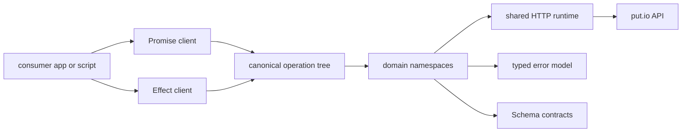

# Architecture

## Where Code Goes

- `src/core/*.ts`: shared runtime, fetch transport, auth, defaults, errors, and
  client composition.
- `src/domains/*.ts`: one file per domain namespace. Split a domain into a
  subfolder only once it grows too large for one file.
- `src/utilities/*.ts`: opt-in helpers exported from `@putdotio/sdk/utilities`.

## Clients

Both clients come from one typed operation tree, `sharedOperationTree` in
[src/core/client.ts](../src/core/client.ts). The Effect client is also a
`PutioSdk` service layer. The Promise client runs its Effect operations through
one managed runtime per instance, which `dispose()` tears down. Lifecycle
methods, token replacement, overload-specific signatures, and pure helpers
stay explicit adapters; mixed Effect/pure overloads are unsupported.

Every operation in the tree is classified as validated, input-free, or pure.
Module initialization throws on an unclassified leaf, so a new request
operation must declare its boundary rule before it joins either client. The
domain operation owns validation, before transport serialization.

Operations derived through the generic Promise adapter check the declared
Effect or non-Effect return kind at call time. The Effect client keeps
canonical function identity and relies on the compile-time return-kind
constraint instead.

## Files

The `files` namespace holds three kinds of operation on purpose:

- JSON methods, such as `files.list(...)`, are schema-shaped.
- Direct route helpers, such as `files.getHlsStreamUrl(...)`, are
  transport-shaped and return URLs.
- Upload helpers, such as `files.upload(...)`, go through `upload.put.io`,
  because `api.put.io/v2/files/upload` is only a redirect shim.

## API Coverage

Endpoint completeness means every supported, user-facing public API capability
has a typed SDK operation, a canonical equivalent, or a direct-route URL
helper. Coverage includes authenticated JSON operations, public registration
and OAuth operations meant for API consumers, and direct content routes that
consumers reach through SDK-generated URLs.

It excludes:

- admin, private, restricted, secret-key, and service-to-service routes
- browser page, callback, and form-post routes
- legacy aliases when the SDK exposes the canonical replacement
- transport aliases when one safer method reaches the same handler and contract

The backend route inventory and private route classifications stay outside
this repository. [`api-route-matrix.json`](./api-route-matrix.json) holds only
public-safe evidence for selected contract decisions; `vp run verify` checks
each named operation on both clients. Nothing detects new backend routes
automatically: repeat the comparison when a public backend route changes or a
first-party consumer needs an unmodeled capability.
